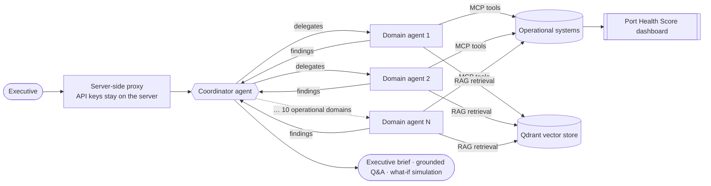

<!--
  GitHub profile README for @sridharan31
  Animated SVGs in /assets are generated by scripts/build-assets.mjs (edit the script, then run `npm run assets`).
  Live cards (stats, languages, skyline, snake) are built by .github/workflows/profile.yml and published to the `output` branch.
  Search for "TODO" to find every placeholder you still need to replace.
-->

<picture>
  <source media="(prefers-color-scheme: dark)" srcset="./assets/banner-dark.svg">
  <source media="(prefers-color-scheme: light)" srcset="./assets/banner-light.svg">
  
</picture>

  
  
  
  

  <a href="#about">About</a> ·
  <a href="#journey">Journey</a> ·
  <a href="#tech-stack">Tech Stack</a> ·
  <a href="#projects">Projects</a> ·
  <a href="#recognition">Recognition</a> ·
  <a href="#ai-engineering">AI Engineering</a> ·
  <a href="#activity">Activity</a> ·
  <a href="#contact">Contact</a>

<!-- ============ ABOUT ============ -->
<h2 id="about">👋 About</h2>

<picture>
  <source media="(prefers-color-scheme: dark)" srcset="./assets/terminal-dark.svg">
  <source media="(prefers-color-scheme: light)" srcset="./assets/terminal-light.svg">
  
</picture>

I'm a Senior Full-Stack Developer at **AD Ports Group** (since 2021), where I architected a modular, multi-tenant **Port Community System** now live in the UAE, Jordan and Egypt, and contribute to the **Angola Logistics Single Window**. Before that, I spent five years at **FSS** delivering UPI, BHIM and NPCI eNACH payment systems for 10+ banks, including State Bank of India, Punjab National Bank and Mashreq Bank.

My work sits where frontend architecture meets distributed backends: Angular micro-frontends, ASP.NET Core microservices, event-driven integration (RabbitMQ, gRPC, Camunda), and Keycloak identity security that holds up in regulated environments. I started out in UI/UX and graphic design, and that still shapes how I build interfaces.

Today I'm applying that same discipline to AI/LLM engineering. I'm building a Claude API-powered executive assistant with MCP tools, RAG and Qdrant vector search, and learning LLM fine-tuning hands-on.

<!-- ============ JOURNEY ============ -->
<h2 id="journey">🧭 Journey</h2>

<picture>
  <source media="(prefers-color-scheme: dark)" srcset="./assets/timeline-dark.svg">
  <source media="(prefers-color-scheme: light)" srcset="./assets/timeline-light.svg">
  
</picture>

<a href="#top">↑ back to top</a>

<!-- ============ TECH STACK ============ -->
<h2 id="tech-stack">🛠️ Tech Stack</h2>

<!-- Icons: https://skillicons.dev (open source). The table below carries the same information if the service is down. -->

   
   
  

<b>Full stack, by area</b> (click to expand)

 

| Area | Technologies |
|---|---|
| **Frontend** | Angular (4–22), React, TypeScript, JavaScript (ES6+), RxJS, NgRx, Angular Material, PrimeNG, Tailwind CSS, SCSS, Transloco (i18n) |
| **Mobile** | Ionic, Capacitor, Apache Cordova |
| **Backend** | .NET (incl. .NET 10) / ASP.NET Core, C#, Clean Architecture, CQRS (MediatR), Node.js, REST |
| **Architecture &amp; Integration** | Microservices, Micro-frontends (Native Federation), gRPC, RabbitMQ / MassTransit, Azure Service Bus, Camunda BPM |
| **Databases** | SQL Server, PostgreSQL, MongoDB |
| **Security &amp; Identity** | Keycloak (OAuth2 / OIDC, UMA), RBAC, AES / RSA encryption, Frida-based mobile hardening |
| **DevOps &amp; Cloud** | Docker, Kubernetes, Helm, ArgoCD (GitOps), Azure DevOps, Azure AKS, VMware Tanzu, CI/CD, Grafana / Prometheus / Loki / Tempo |
| **Agents** | Claude API, MCP, tool use &amp; function calling, coordinator / orchestrator multi-agent pattern, ReAct, agent memory &amp; state, LangGraph, LangChain, CrewAI, AutoGen, LlamaIndex |
| **RAG &amp; Vector Search** | Embeddings, Qdrant, Pinecone, Weaviate, Chroma, pgvector |
| **LLMOps &amp; Serving** | OpenAI &amp; Gemini APIs, LiteLLM gateway, Vercel AI SDK, vLLM, TGI, Ollama, LangSmith, Langfuse, Weights &amp; Biases |
| **Fine-tuning &amp; Evaluation** | SFT, PEFT (LoRA / QLoRA), DPO, Hugging Face Transformers / PEFT / TRL, Unsloth, quantization (GGUF, GPTQ, AWQ) · custom evals, LLM-as-judge, guardrails, prompt-injection defense *(learning)* |
| **Design &amp; Tools** | Git, GitHub Actions, Figma, Adobe XD, Photoshop, Illustrator, wireframing, user research |

<!-- TODO: Remove anything you would not be comfortable discussing in an interview. -->

<h3 id="engineering-highlights">Engineering highlights</h3>

<table>
  <tr>
    <td width="50%" valign="top">
      🏛️ <b>Enterprise architecture</b> 
      Multi-tenant microservice platforms with clear domain boundaries, rolled out across multiple countries.
    </td>
    <td width="50%" valign="top">
      🧩 <b>Micro-frontends &amp; reusable UI</b> 
      Angular Native Federation shells, shared component libraries, localization built in from day one.
    </td>
  </tr>
  <tr>
    <td valign="top">
      🔗 <b>Distributed integration</b> 
      gRPC, RabbitMQ / MassTransit and Camunda workflows connecting services and government systems.
    </td>
    <td valign="top">
      🔐 <b>Security by default</b> 
      Keycloak-based identity, RBAC, encryption and mobile app hardening for banking-grade apps.
    </td>
  </tr>
  <tr>
    <td valign="top">
      📈 <b>Performance &amp; maintainability</b> 
      Clean Architecture, CQRS and observability (Grafana, Prometheus, Loki, Tempo) to keep systems fast and debuggable.
    </td>
    <td valign="top">
      🤖 <b>Intelligent workflows</b> 
      LLM agents grounded in operational data, with server-side key handling and tool access via MCP.
    </td>
  </tr>
</table>

<a href="#top">↑ back to top</a>

<!-- ============ PROJECTS ============ -->
<h2 id="projects">🚀 Featured Projects</h2>

<!-- Cards 1 and 2 describe work projects: code is proprietary, so no repo link. -->
<table>
  <tr>
    <td width="50%" valign="top">
      <h3>🏗️ Port Community System</h3>
      Enterprise full-stack · AD Ports Group
      
Modular, multi-tenant platform covering service management, payments, documents and tenant/user management. Architected and delivered end to end, and led the country rollouts for Jordan and Egypt: localization, payment integrations, Camunda approvals, UAT and go-live.

      
<code>Angular</code> <code>ASP.NET Core</code> <code>SQL Server</code> <code>MongoDB</code> <code>Keycloak</code> <code>Camunda</code> <code>Kubernetes</code>

      Proprietary · <!-- TODO: link a public case study or LinkedIn post if you have one --> case study coming soon
    </td>
    <td width="50%" valign="top">
      <h3>🤖 Executive Digital Twin</h3>
      Multi-agent LLM assistant · AD Ports Group
      
Unifies 10 operational domains into a single Port Health Score dashboard, with an "AI Chief of Staff" on top: domain agents linked through a coordinator agent produce executive briefs, grounded Q&amp;A and what-if simulations. A server-side proxy keeps API keys off the client.

      
<code>Claude API</code> <code>MCP</code> <code>RAG</code> <code>Qdrant</code>

      Proprietary · architecture sketch below ↓
    </td>
  </tr>
  <tr>
    <td valign="top">
      <h3>🌍 Angola Logistics Single Window</h3>
      JUL Platform · AD Ports Group
      
A 14-microservice .NET 10 platform. I built Angular 22 Native Federation micro-frontends for customs declarations, CNCA licensing and agent nomination, integrated with ASYCUDA, SINTECE and SICOEX.

      
<code>.NET 10</code> <code>Angular 22</code> <code>RabbitMQ / MassTransit</code> <code>ArgoCD</code> <code>Helm</code> <code>Tanzu</code> <code>AKS</code>

      Proprietary
    </td>
    <td valign="top">
      <h3>💳 NPCI eNACH &amp; UPI Payments</h3>
      Banking platforms · FSS
      
Led the front-end of the NPCI eNACH clearing system (secure mandate registration and transaction tracking), and built UPI / BHIM web and Ionic mobile apps for 10+ banks, hardened with AES/RSA and Frida-based checks.

      
<code>Angular</code> <code>Ionic</code> <code>Cordova</code> <code>AES / RSA</code>

      Proprietary · 🏆 FSS eNACH Best Performance Award
    </td>
  </tr>
  <tr>
    <td valign="top">
      <h3>🔎 RAGAPP</h3>
      Retrieval-Augmented Generation
      <!-- TODO: verify this description against the repo and adjust -->
      
Full-stack RAG application with a Node.js / Express API, MongoDB, a separate frontend and Docker Compose setup, with configurable AI providers.

      
<code>Node.js</code> <code>Express</code> <code>MongoDB</code> <code>Docker</code>

      <a href="https://github.com/sridharan31/RAGAPP">View repository →</a>
    </td>
    <td valign="top">
      <h3>🧪 Agentic AI Lab</h3>
      Agents &amp; advanced RAG experiments
      
Hands-on notebooks for single- and multi-agent systems, LangChain vs. LangGraph, Corrective RAG, Self-RAG and Pydantic-validated outputs.

      
<code>Python</code> <code>LangGraph</code> <code>LangChain</code> <code>Pydantic</code>

      <a href="https://github.com/sridharan31/Agentic-AI">View repository →</a>
    </td>
  </tr>
</table>

<b>How the Executive Digital Twin is wired</b> (click to expand)

 

<!-- GitHub renders Mermaid natively; it follows the viewer's light/dark theme automatically. -->

<!--
  TODO (optional 5th card): Developer productivity / open-source tooling.
  Copy one <td> block above when you publish a tool, e.g. an Angular component library,
  an MCP server, or a CLI. Do not add it until the repository exists.
-->

<a href="#top">↑ back to top</a>

<!-- ============ RECOGNITION ============ -->
<h2 id="recognition">🏆 Recognition &amp; Learning</h2>

<table>
  <tr>
    <td width="50%" valign="top">
      🥇 <b>Outstanding Performance Award</b> 
      AD Ports Group 
      Performance optimization of the Abu Dhabi Maritime Bridges operation.
    </td>
    <td width="50%" valign="top">
      🥇 <b>eNACH Best Performance Award</b> 
      FSS 
      Led the front-end of the NPCI eNACH clearing system.
    </td>
  </tr>
</table>

<b>Education &amp; certifications</b> (click to expand)

 

- 🎓 **B.E., Electronics and Communication Engineering**, Anna University, Chennai (2007–2011)
- 📜 LLM Engineering: Master AI, Large Language Models &amp; Agents (Udemy)
- 📜 LLM Fine-Tuning (YouTube)
- 📜 React: The Complete Guide 2023, incl. React Router &amp; Redux (Udemy)
- 📜 Node.js, Express, MongoDB &amp; More: The Complete Bootcamp (Udemy)
- 📜 Agile Fundamentals: Scrum &amp; Kanban (Udemy)

<a href="#top">↑ back to top</a>

<!-- ============ AI ENGINEERING ============ -->
<h2 id="ai-engineering">🧠 AI Engineering Journey</h2>

What I'm building and learning, and where I am on each:

| Focus | What I work on | Status |
|---|---|---|
| **LLM application architecture** | Server-side proxy pattern, provider gateways (LiteLLM), streaming UIs | 🟢 Applied at work |
| **Tool-calling agents &amp; MCP** | Coordinator / domain-agent design, MCP tool servers | 🟢 Applied at work |
| **RAG pipelines** | Chunking, embeddings, Qdrant, Corrective &amp; Self-RAG | 🟡 Building |
| **Fine-tuning** | SFT with LoRA / QLoRA on open models — see [LLM_FineTune](https://github.com/sridharan31/LLM_FineTune) | 🔵 Learning |
| **Evaluation &amp; guardrails** | Grounding checks, structured outputs, prompt-injection awareness | 🔵 Learning |

<!-- TODO: Update the Status column as you progress. Honest labels build more trust than inflated ones. -->

<a href="#top">↑ back to top</a>

<!-- ============ GITHUB ACTIVITY ============ -->
<h2 id="activity">📊 GitHub Activity</h2>

<!--
  These cards are generated by .github/workflows/profile.yml every 12 hours and live on the `output` branch.
  They appear after the workflow's first run (Actions tab → "Refresh profile cards" → Run workflow).
-->

  <picture>
    <source media="(prefers-color-scheme: dark)" srcset="https://raw.githubusercontent.com/sridharan31/sridharan31/output/stats-dark.svg">
    <source media="(prefers-color-scheme: light)" srcset="https://raw.githubusercontent.com/sridharan31/sridharan31/output/stats-light.svg">
    
  </picture>
  <picture>
    <source media="(prefers-color-scheme: dark)" srcset="https://raw.githubusercontent.com/sridharan31/sridharan31/output/languages-dark.svg">
    <source media="(prefers-color-scheme: light)" srcset="https://raw.githubusercontent.com/sridharan31/sridharan31/output/languages-light.svg">
    
  </picture>

  <picture>
    <source media="(prefers-color-scheme: dark)" srcset="https://raw.githubusercontent.com/sridharan31/sridharan31/output/skyline-dark.svg">
    <source media="(prefers-color-scheme: light)" srcset="https://raw.githubusercontent.com/sridharan31/sridharan31/output/skyline-light.svg">
    
  </picture>

  <picture>
    <source media="(prefers-color-scheme: dark)" srcset="https://streak-stats.demolab.com/?user=sridharan31&hide_border=true&background=0F1A2E&stroke=1E2A44&ring=22D3EE&fire=A78BFA&currStreakNum=F1F5F9&sideNums=F1F5F9&currStreakLabel=22D3EE&sideLabels=94A3B8&dates=475569">
    <source media="(prefers-color-scheme: light)" srcset="https://streak-stats.demolab.com/?user=sridharan31&hide_border=true&background=FFFFFF&stroke=D9E2EC&ring=0891B2&fire=7C3AED&currStreakNum=0F172A&sideNums=0F172A&currStreakLabel=0891B2&sideLabels=475569&dates=94A3B8">
    
  </picture>

  <picture>
    <source media="(prefers-color-scheme: dark)" srcset="https://raw.githubusercontent.com/sridharan31/sridharan31/output/snake-dark.svg">
    <source media="(prefers-color-scheme: light)" srcset="https://raw.githubusercontent.com/sridharan31/sridharan31/output/snake-light.svg">
    
  </picture>

<a href="#top">↑ back to top</a>

<!-- ============ CONTACT ============ -->
<h2 id="contact">🤝 Contact</h2>

  
  
  <!-- TODO: replace YOUR-PORTFOLIO-URL, or delete this badge if you don't have a portfolio yet -->
  

Happy to talk about enterprise architecture, Angular at scale, or practical LLM agents.

<!--
  ================= VALIDATION CHECKLIST (not rendered) =================
  [ ] Repository is public and named exactly "sridharan31"
  [ ] Settings → Actions → General → Workflow permissions: "Read and write" (needed to push the `output` branch)
  [ ] Actions → "Refresh profile cards" → Run workflow once; stats, skyline and snake then appear
  [ ] Banner, terminal and timeline switch correctly: toggle GitHub Settings > Appearance (light / dark)
  [ ] Every "View repository" link opens the right repo
  [ ] Portfolio placeholder replaced or removed (search "YOUR-")
  [ ] Mermaid diagram renders inside the "How the Executive Digital Twin is wired" dropdown
  [ ] Mobile: open the profile in the GitHub app / phone browser; cards stack and remain readable
  [ ] Accessibility: every image has meaningful alt text; animations stop under "reduce motion"
  [ ] Factual accuracy: every technology and status label is something you can discuss in an interview
  =======================================================================
-->
